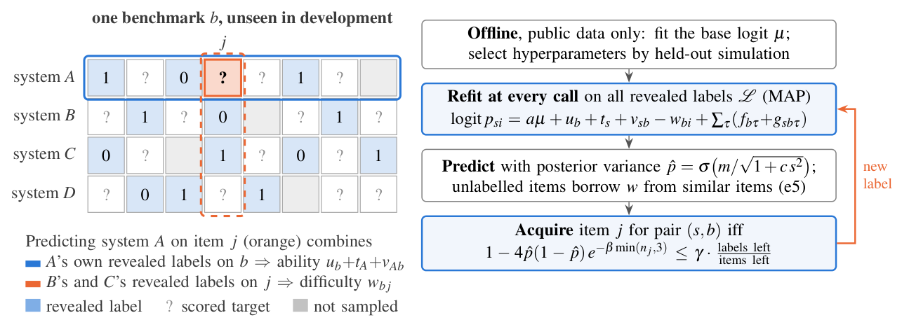
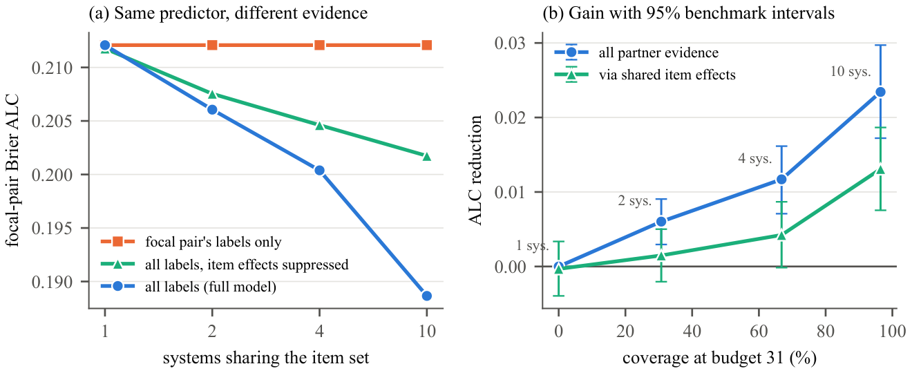
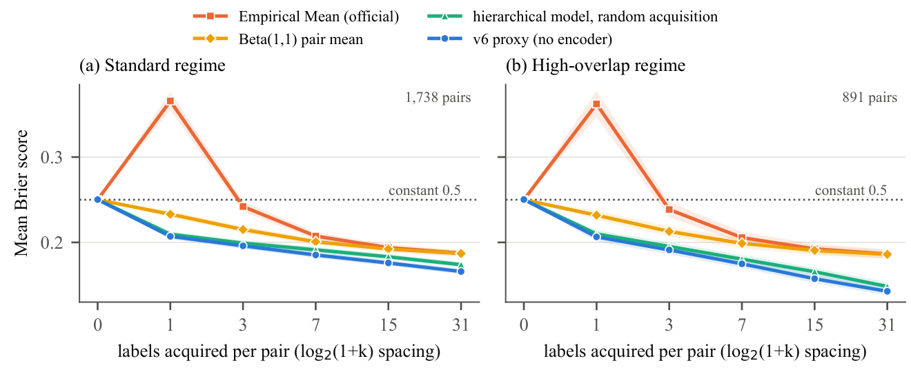
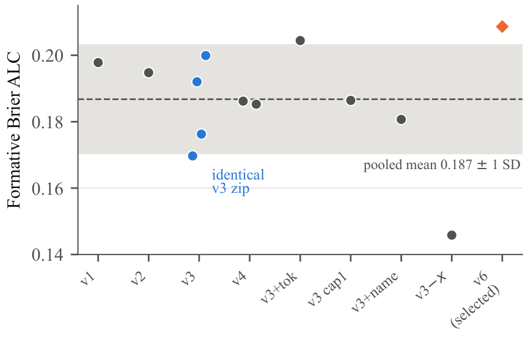

<div align="center">

# Items Are Shared, Abilities Are Not

### Predicting AI Correctness on Unseen Benchmarks from Other Systems' Labels

**Vaibhav Kanojia** · NeurIPS 2026 Predictive AI Evaluation Competition (PAIEC)

[](paper/main.pdf)
[](https://www.codabench.org/competitions/17828/)
[](https://aims.stanford.edu/competition)
[](#reproduce-the-paper)
[](#the-submitted-package)
[](LICENSE)

</div>

---

PAIEC asks for predictions of whether an AI system answers an item correctly on **benchmarks never seen in development**, with at most **31 revealed labels per system–benchmark pair**. The evaluator exposes the labels acquired for *all* sampled systems, so another system's outcome on the *same item* is legitimate evidence about that item's difficulty. This repository contains our submission, a protocol simulator, every experiment, and the technical report.

<p align="center">
  
</p>

## Highlights

- **A test-time item response model.** At every call it refits benchmark, system, pair, item and item-category effects on all revealed labels (MAP with tuned shrinkage). It uses a budget-paced uncertainty rule with a coverage term that prefers items no system has revealed yet. CPU only, one 118M-parameter open encoder.
- **When partner labels help, measured directly.** In a fixed-target study with a held-out prior, giving the *same* predictor the labels of 9 partner systems improves the focal system's Brier ALC by **0.0234** [0.0172, 0.0297]. Shared item effects account for **0.0131** of that. With no partners the gain is zero, by construction.
- **Strong baselines and honest boundaries.** The model beats two cheap shrinkage baselines clearly when systems share items. For isolated pairs its advantage over a Beta-smoothed pair mean is inconclusive. Categorical item features help in every regime.
- **Replayable evaluation.** The simulator uses one-response reveals and benchmark-held-out folds. Benchmark-bootstrap intervals are reported throughout, and an independent script re-checks all 102 reported numbers.

## Results

Brier area under the learning curve (lower is better) in benchmark-held-out simulation. Acquisition reveals one binary response, and the model row is the embedding-free proxy of the submitted package.

| Method | Standard | High overlap | Sparse, 2 systems | Sparse, 1 system |
|---|:---:|:---:|:---:|:---:|
| Constant 0.5 | 0.2500 | 0.2500 | 0.2500 | 0.2500 |
| Empirical Mean (official baseline) | 0.2455 | 0.2434 | 0.2383 | 0.2472 |
| Beta(1,1) pair mean | 0.2119 | 0.2105 | 0.2067 | 0.2140 |
| Pair mean shrunk to benchmark rate | 0.2077 | 0.2068 | 0.2070 | 0.2178 |
| **Ours (v6, submitted)** | **0.1945** | **0.1853** | **0.1969** | **0.2125** |

With a single system per benchmark, the difference from the Beta pair mean (0.0015) is within its 95% interval.

<p align="center">
  
  <br/><sub><b>Partner evidence helps more as more systems share the items.</b> The same predictor is given only the focal pair's labels, all labels with item effects suppressed, or all labels. Coverage is the share of focal evaluation items revealed for at least one partner by budget 31.</sub>
</p>

<details>
<summary><b>More figures</b>: learning curves and official-score variability</summary>
<br/>
<p align="center"></p>
<p align="center"><sub>Brier score at each checkpoint. The official Empirical Mean spikes at budget 1, shrinkage removes the spike, and the item response model keeps improving as labels accumulate.</sub></p>
<p align="center"></p>
<p align="center"><sub>Official formative scores are single draws of a resampled hidden subset: four uploads of the identical package scored 0.170–0.200.</sub></p>
</details>

## The submitted package

| | |
|---|---|
| File | [`dist/paiec_v6.zip`](dist/paiec_v6.zip), the exact uploaded file |
| Codabench submission | **1031141** |
| SHA-256 | `d091ae066618c26d11c7bbc26d926e5a169b4bd96c64034f18cbbfcbab742543` |
| Entry points | `model.py` → `predict(input, labeled)`, `labeling.py` → `acquisition_function(...)` |
| External model | `intfloat/multilingual-e5-small`, declared in `models.txt`; falls back to the text-free model if it cannot load |

Rebuild an equivalent package from source and check it with the organisers' checker ([`paiec_baseline`](https://github.com/aims-foundations/paiec_baseline), cloned next to this repo):

```bash
python paiec/build_submission.py \
  --hp '{"a":0.4,"s_u":1.4,"s_t":0.5,"s_v":1.0,"s_w":2.2,"c":0.1,"n_cap":1.0,"tau_w":0.02,"kappa_w":0.3,"s_f":0.7,"s_g":0.3}' \
  --acq '{"gamma":1.0,"beta":1.0}' --text --no_name_prior --no_name_pool --text_tokens --template_tokens \
  --out dist/paiec_v6_rebuilt.zip
python paiec_baseline/check_submission_zip.py dist/paiec_v6_rebuilt.zip
```

CPU smoke test through the official dictionary interface (public data; 6 benchmarks × 4 systems; needs the processed tables). This harness reveals each acquired item's whole response cell and leaves `interactors` empty, so its score is a functional check, not a paper result:

```bash
mkdir -p /tmp/v6 && unzip -o dist/paiec_v6.zip -d /tmp/v6
python paiec/test_submission.py /tmp/v6 --benches 6 --subj 4 --eval 30 --seed 5
```

## Requirements and hardware

| | What we used | What you need |
|---|---|---|
| Python | 3.10.11 | ≥ 3.10; `pip install -r requirements.txt` (pinned versions) |
| CPU / RAM | Laptop, 12th Gen Intel Core i7-1250U (12 threads), 16 GB RAM | Any recent CPU; 16 GB RAM to build the tables from raw data, 4 GB to verify from bundled outputs |
| GPU | Cloud notebook sessions with 2× NVIDIA T4 (16 GB), only for computing text embeddings and running some simulations in parallel | **Not required.** The submitted package runs on CPU, and all main tables use embedding-free proxies |
| Disk | 8.5 GB raw tables, 2 GB processed | ~11 GB to recompute from raw data; ~50 MB for this repository |
| Time | Each simulator regime takes minutes to ~1 h on the laptop; the package scores ~19 pairs per minute on CPU | Same |

## Reproduce the paper

**1. Verify every number from this repository alone** (minutes, no data download)

```bash
pip install -r requirements.txt
python paper/scripts/verify_numbers.py  # independent recomputation: 102 checks, non-zero exit on any mismatch
python paper/scripts/analyze_r7.py      # all intervals -> paper/results.tex (uses bundled logbooks/runs/r7_pairs_meta.npz)
python paper/scripts/fig_overlap.py && python paper/scripts/fig_curves.py && python paper/scripts/fig_noise.py
cd paper && latexmk -pdf main.tex
```

**2. Recompute from raw data.** The measurement-db core tables are about 8.5 GB; you need a Hugging Face token with access to the gated dataset.

```bash
python scripts/download_core.py && python scripts/build_tables.py
python scripts/build_items.py && python scripts/subset.py

HP='{"a":0.4,"s_u":1.4,"s_t":0.5,"s_v":1.0,"s_w":2.2,"c":0.1,"n_cap":1.0,"s_f":0.7,"s_g":0.3}'
M=const,emp_mean,beta11,eb_bench,online0,online0@g1,online0_f@g1,online0_f,online0_f@g1c1,online_name_f@g1c1
E="python paiec/evaluate.py --subset data/proc/subset10k.parquet --tok both --template --single --no_provider --methods $M --hp $HP"
$E --tag R7_std                                   # standard regime
$E --formative 100 --tag R7_high                  # high overlap
$E --formative 100 --rows 200 --tag R7_sp2        # sparse, 2 systems per benchmark
$E --formative 100 --rows 100 --tag R7_sp1        # sparse, 1 system per benchmark
python paiec/overlap.py --seed 0 && python paiec/overlap.py --seed 1   # controlled overlap study
```

Method names: `online0` is the hierarchical model; `_f` adds item tokens; `online_name_` adds the known-name offset (ablation only); `@g1` means uncertainty acquisition with γ = 1; `c1` adds the coverage term; `o` adds the overlap gate (ablation only).

[`MANIFEST.md`](MANIFEST.md) lists hashes, data and encoder versions, the environment, and which files produce each table and figure.

## Repository layout

```
paiec/submission/   competition package sources (model.py, labeling.py, text_prior.py)
paiec/online.py     the test-time item response model (shared by package and simulator)
paiec/sim.py        protocol simulator: splits, streaming acquisition, checkpoints, Brier ALC
paiec/evaluate.py   benchmark-held-out evaluation of methods (writes per-pair curves)
paiec/overlap.py    controlled overlap study
paiec/acq.py        acquisition policies used in simulation
scripts/            data download, table building, EDA, Kaggle orchestration
paper/              LaTeX source, figure scripts, results manifest, verification script
logbooks/           every experiment, including negative results, and raw run outputs
dist/paiec_v6.zip   the submitted package
```

## Citation

```bibtex
@misc{kanojia2026items,
  title  = {Items Are Shared, Abilities Are Not: Predicting AI Correctness on Unseen Benchmarks from Other Systems' Labels},
  author = {Kanojia, Vaibhav},
  year   = {2026},
  note   = {Technical report, NeurIPS 2026 Predictive AI Evaluation Competition (PAIEC)},
  url    = {https://github.com/VaibhavKanojia3773/items-are-shared-paiec}
}
```

## Disclosures

- **Data:** public measurement-db only.
- **Pretrained model:** `intfloat/multilingual-e5-small` (MIT licence), frozen. No LLM is called at scoring time.
- **Offline pilot:** open LLMs, accessed through the NVIDIA API, rated public items. This did not influence the submitted method.
- **AI assistance:** development used Claude Code (Anthropic) as a coding and writing assistant, as the competition asks entrants to disclose.
- **Cloud runs:** the orchestration scripts in `scripts/kaggle_push_*.py` read the account from your own `~/.kaggle/<profile>/kaggle.json`, and the data upload uses your own HF token. No credentials are included.

Code is released under the [MIT License](LICENSE).
